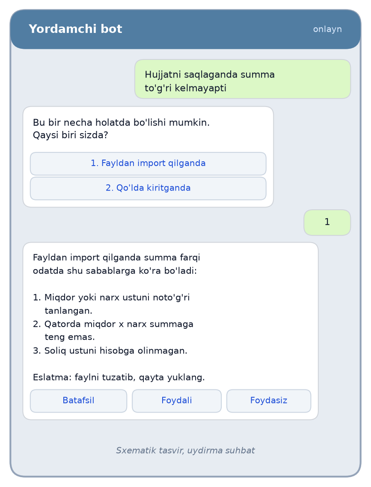
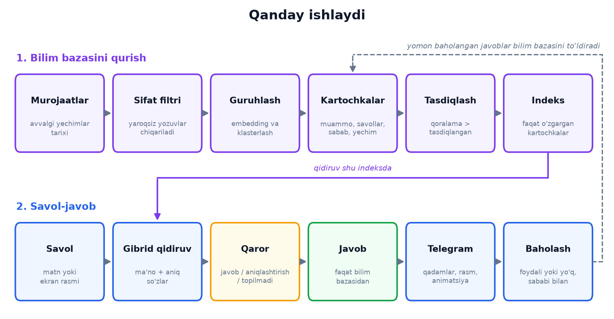
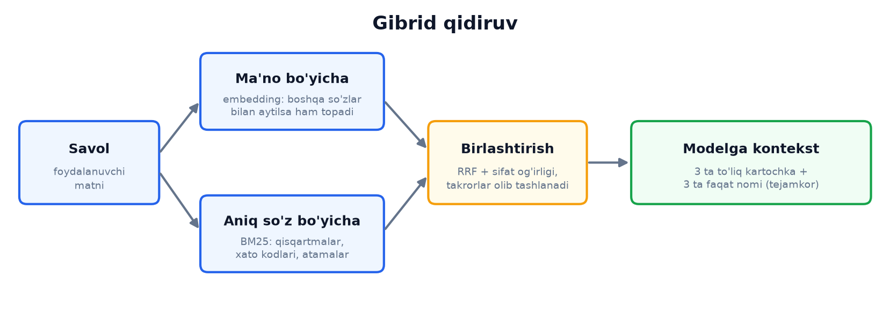

# RAG Support Assistant

> **English summary.** An AI support assistant I built on retrieval-augmented generation. It answers users'
> questions **only from a curated knowledge base**, asks a clarifying question when a request is ambiguous,
> understands screenshots, and replies in Telegram with step-by-step images and short process videos.
> Hybrid search (embeddings + BM25 merged with RRF), a knowledge base built from real support history,
> answer feedback, retrieval and end-to-end evaluation, and a switch between Gemini and fully local models
> (Ollama). This repository is a description only; the code and the knowledge base are not published.
> To design a similar AI assistant for your business, contact me on Telegram:
> [@offon_ai](https://t.me/offon_ai). All rights reserved.

Foydalanuvchilarning texnik savollariga **faqat tasdiqlangan bilim bazasidan** javob beradigan AI yordamchi.
U savolni tushunadi, kerak bo'lsa aniqlashtiradi, ekran rasmini o'qiy oladi va javobni Telegram'da
qadam-baqadam rasmlar va qisqa videolar bilan beradi.

## Nima qiladi

### Javob berish
- **Faqat bilim bazasidan.** Mos ma'lumot topilmasa, o'ylab topmaydi: "Bilim bazasida ma'lumot topilmadi,
  texnik yordamga murojaat qiling" deydi.
- **Aniqlashtiruvchi savol.** Savol bir nechta mavzuga to'g'ri kelsa, 2-4 variant taklif qiladi.
  Foydalanuvchi raqam yoki o'z so'zi bilan tanlaydi.
- **Suhbat xotirasi.** Oxirgi 3 ta savol-javobni eslaydi, shuning uchun "u yerda nima yoziladi?" kabi davom
  savollarni tushunadi.
- **Ekran rasmini tushunadi.** Foydalanuvchi skrinshot yuborsa, oyna nomini, xato matnini va belgilangan
  joylarni o'qib, savolni o'zi tuzadi.

### Telegram bot
- Har bir foydalanuvchining suhbati alohida, variantlar tugma bo'lib chiqadi, "Yangi suhbat" xotirani tozalaydi.
- Qisqa javob va **"Batafsil"** tugmasi.
- Javob bilan birga **qadam-baqadam rasmlar** va **jarayon videolari**.
- Har bir javobni **"foydali / foydasiz"** deb baholash mumkin, sababi bilan. Administrator statistikani,
  Excel hisobotni va grafikni oladi.
- Excel hisob-faktura yuborilsa, jadvalni tekshiradi: miqdor, narx va jami summalarni **kod hisoblaydi**,
  AI faqat natijani tushunarli qilib tushuntiradi.
- Faqat ruxsat berilgan foydalanuvchilar ishlata oladi. Xato bo'lsa, bot o'zi qayta ishga tushadi.

### Bilim bazasi
- Oddiy **Excel jadvallari**, har bir bo'lim alohida faylda. Har bir qator bitta kartochka: muammo, savol
  variantlari, sabablar, yechim, eslatma.
- Kartochka holati: **qoralama, tasdiqlangan, o'chirilgan.** O'chirilgan kartochka hech qachon ishlatilmaydi,
  qoralamalarni ishlatish esa sozlamada yoqiladi yoki o'chiriladi (sinov davri uchun qulay).
- Jadval tahrirlangach, **faqat o'zgargan kartochkalar** qayta indekslanadi.

## Qanday ishlaydi

**1. Bilim bazasini qurish.** Kartochkalar avvalgi murojaatlar va ularning yechimlari tarixidan tuziladi.
Avval sifatsiz yozuvlar chiqarib tashlanadi (masalan, suhbat uzilgan yoki yechim qanday qilingani
yozilmagan). So'ng o'xshash murojaatlar embedding va klasterlash bilan guruhlanadi, har bir guruhdan
kartochka yoziladi. Mutaxassis tekshirgach, kartochka tasdiqlanadi.

**2. Savol-javob.** Savol gibrid qidiruvdan o'tadi. Tizim uch qarordan birini tanlaydi: javob berish,
aniqlashtirish yoki "topilmadi". Javob faqat topilgan kartochkalardan yoziladi. Yomon baholangan javoblar
bilim bazasini to'ldirish uchun yig'iladi.

### Gibrid qidiruv

Ma'no bo'yicha qidiruv boshqa so'zlar bilan aytilgan savolni ham topadi, lekin qisqartmalar va xato kodlarida
adashishi mumkin. BM25 aniq so'zlarni yaxshi topadi. Ikkalasining natijasi RRF bilan birlashtiriladi, deyarli
bir xil kartochkalar takrorlanmaydi.

## Sifat va tejamkorlik

- **Qidiruv aniqligi o'lchanadi:** real murojaatlar savol sifatida beriladi va tizim to'g'ri kartochkani
  topdimi, tekshiriladi. Bu bosqichda model chaqirilmaydi, shuning uchun arzon.
- **To'liq sinov:** tayyor savollar to'plamida har savol uchun kutilgan kartochka va kutilgan xatti-harakat
  (javob, aniqlashtirish yoki topilmadi) tekshiriladi, sarflangan tokenlar bilan.
- **Tejamkor kontekst:** modelga 3 ta to'liq kartochka va yana 3 tasining faqat nomi beriladi. Variant
  tanlangach, faqat o'sha kartochka yuboriladi. Odatda bitta xabarga bitta model chaqiruvi va o'rtacha
  ~4 ming token ketadi. Ekran rasmi taxminan 1-1,5 ming token qo'shadi.

## O'quv materiallari

Bot javoblaridagi rasm va videolar ham avtomatlashtirilgan:

- O'quv videolari AI bilan qadam-baqadam tahlil qilinadi, ovozi vaqt belgilari bilan matnga aylantiriladi.
- Ekran yozuvidan **tushuntiruvchi video** yasaladi: har bir bosishdan oldin to'xtaydi va "nega shu joy
  bosilyapti" izohini chiqaradi. Sichqoncha kursori OpenCV bilan kuzatiladi.
- Qadam-baqadam GIF va kerakli tugmalari ramka bilan belgilangan rasmlar.
- Maxfiylik: brauzer manzil satri va tizim paneli kesib tashlanadi, shaxsiy va tashkilot ma'lumotlari
  xiralashtiriladi.

## Model tanlash

Sukut bo'yicha Gemini (embedding va javob). Sozlamada bitta qatorni o'zgartirib, **to'liq lokal** ishlashga
o'tish mumkin: Ollama orqali `bge-m3` embedding va `Qwen2.5 14B` modeli. Shunda savollar va bilim bazasi
tashqi AI xizmatiga yuborilmaydi.

## Texnologiyalar

Python, Gemini API (matn, rasm, video), Ollama (bge-m3, Qwen2.5), BM25, RRF, embedding va klasterlash,
SQLite, Excel, OpenCV, ffmpeg, Pillow, Telegram Bot API.

## Bu repoda nima bor

Faqat tizimning tavsifi va sxematik rasmlar. Kod, bilim bazasi va foydalanuvchi ma'lumotlari ochiq
qo'yilmagan. Rasmlardagi suhbat va matnlar uydirma.

## Aloqa

Shunga o'xshash AI yordamchilarini loyihalash va joriy qilish bo'yicha Telegram'da yozing:
**[@offon_ai](https://t.me/offon_ai)**.

© 2026 Navruzbek Abduganiyev. Barcha huquqlar himoyalangan.
